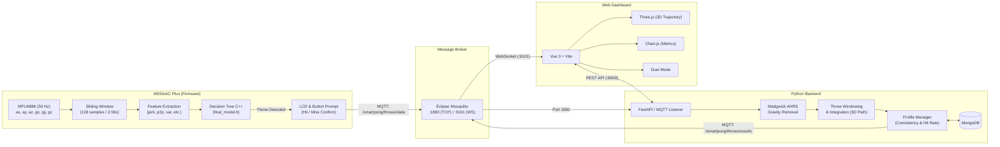

# SmartPong 🏓

**SmartPong** is an IoT- and ML-powered tracking system for Beer Pong. Using a wrist-worn **M5StickC Plus** (ESP32), it detects throws on-device in real time, collects player feedback (Hit vs. Miss), computes biomechanical metrics (peak acceleration, lateral drift, and reconstructed 3D trajectories), and streams live results to an interactive web dashboard for real-time analytics and head-to-head duels.

---

## Table of Contents
- [Main Idea](#main-idea)
- [Software Architecture](#software-architecture)
- [Project Structure](#project-structure)
- [How to Run](#how-to-run)
  - [1. Backend Stack (Docker Compose)](#1-backend-stack-docker-compose)
  - [2. Firmware (M5StickC Plus)](#2-firmware-m5stickc-plus)
  - [3. Testing / Simulation Without Hardware](#3-testing--simulation-without-hardware)
- [Machine Learning Pipeline](#machine-learning-pipeline)
- [Limitations & Remaining Challenges](#limitations--remaining-challenges)

---

## Main Idea

Traditional recreational games like Beer Pong lack objective feedback and quantitative performance metrics. SmartPong turns any standard game into a connected experience:

1. **On-Wrist Sensing & Edge ML**: An M5StickC Plus worn on the throwing wrist samples 6-axis inertial data (accelerometer + gyroscope) at 50 Hz. An embedded Decision Tree continuously classifies arm movement in sliding windows, detecting throws right at the edge with zero cloud latency.
2. **Instant Outcome Labeling**: Immediately upon detecting a throw, the device prompts the player on its LCD (`HIT OR MISS?`) to confirm the outcome with a hardware button press within a 10-second window.
3. **Sensor Fusion & Biomechanical Analytics**: Raw window data is transmitted via MQTT to a Python backend. Using a Madgwick AHRS filter and double numerical integration, the backend strips gravitational acceleration, segments the release phase from the wind-up, computes peak acceleration, calculates lateral drift angle, and reconstructs a 3D flight trajectory.
4. **Live Visualization & Gamification**: A Vue 3 dashboard subscribes to real-time throw events via MQTT-over-WebSocket and REST APIs, rendering 3D trajectory replays (Three.js), throw control & drift meters, player consistency statistics, and a head-to-head Duel Mode.

---

## Software Architecture

The system consists of four primary components arranged in a decoupled, event-driven pipeline:



### Component Breakdown

1. **Firmware** ([`firmware/`](firmware)):
   - Built on ESP-IDF 5.x in C/C++.
   - Samples the MPU6886 IMU at 50 Hz (20 ms interval).
   - Maintains a 128-sample circular buffer (~2.56s) with a 64-sample step (50% overlap).
   - Computes 7 statistical features (`mean_x`, `mean_y`, `mean_z`, `signal_variance`, `max_abs_jerk`, `peak_to_peak`, `kurtosis`).
   - Executes an exported C++ Decision Tree classifier ([`final_model.h`](firmware/main/classifier/final_model.h)).
   - Prompts for player input via buttons (GPIO 37 / GPIO 39) and publishes payload JSON to `/smartpong/throws/data`.

2. **MQTT Broker** ([`mosquitto/`](mosquitto)):
   - Eclipse Mosquitto 2 container.
   - Dual listeners: Port `1883` (standard MQTT for firmware and backend) and Port `9001`/`9101` (MQTT-over-WebSocket for browser clients).

3. **Backend** ([`backend/`](backend)):
   - Python 3 / FastAPI with `fastapi-mqtt`.
   - **Madgwick Filter**: Computes orientation quaternions to convert sensor-frame acceleration to world-frame linear acceleration without gravity.
   - **Trajectory & Dynamics**: Segments the core throw motion, performs double integration to reconstruct 3D trajectory coordinates, and calculates covariance eigenvalues to evaluate lateral drift angle.
   - **Player Profiles**: Categorizes control and drift using historical moving averages and standard deviations, persisting records in MongoDB.
   - Publishes processed results to `/smartpong/throws/results` and serves REST endpoints (`/users`, `/profiles/{user_id}`).

4. **Frontend** ([`frontend/`](frontend)):
   - Vue 3 Single Page Application bundled with Vite.
   - Subscribes directly to Mosquitto via WebSocket for low-latency live throw updates.
   - Visualizes 3D throw trajectories using Three.js, plots historical hit rates with Chart.js, and provides head-to-head match scoring in Duel Mode.

---

## Project Structure

```text
SmartPong/
├── docker-compose.yml              # Orchestrates MongoDB, Mosquitto, Backend, and Frontend
├── mosquitto/
│   └── config/mosquitto.conf       # Config for native MQTT (1883) & WebSockets (9001)
├── backend/
│   ├── Dockerfile                  # Python container specification
│   ├── main.py                     # FastAPI app, MQTT subscriber/publisher, REST routes
│   ├── metrics.py                  # Madgwick filter, throw segmentation, 3D path integration
│   ├── profiles.py                 # User profile models, statistics & MongoDB persistence
│   └── requirements.txt            # Python dependencies (fastapi, fastapi-mqtt, pymongo, etc.)
├── frontend/
│   ├── Dockerfile                  # Nginx production build / dev container
│   ├── package.json                # Dependencies (Vue 3, Three.js, Chart.js, mqtt)
│   ├── vite.config.js              # Vite bundler configuration
│   └── src/
│       ├── App.vue                 # Root layout & view navigation
│       └── components/
│           ├── Dashboard.vue       # Main performance analytics view
│           ├── Throw3DViewer.vue   # Three.js interactive 3D trajectory inspection
│           ├── DuelMode.vue        # 2-player competitive match tracking
│           ├── QualityMeter.vue    # Visual control & drift indicators
│           ├── PlayerSelect.vue    # Profile selector & user switcher
│           └── Settings.vue        # System configuration & MQTT connection settings
├── firmware/
│   ├── CMakeLists.txt              # ESP-IDF CMake build config
│   └── main/
│       ├── app_main.c              # Application entry point & FreeRTOS task startup
│       ├── windowing_task.cpp      # IMU sampling loop, window buffer & hit/miss button logic
│       ├── feature_extraction.cpp  # Time-domain statistical feature extraction
│       ├── m5stickc_plus.c         # Hardware abstraction (MPU6886, LCD ST7789, AXP192)
│       ├── mqtt_logic.c            # ESP-IDF MQTT client, mDNS discovery & payload serialization
│       └── classifier/
│           └── final_model.h       # Autogenerated C++ Decision Tree (from scikit-learn)
├── classification/
│   └── Classification.ipynb        # Data preparation, EDA, feature selection & model export
└── data/                           # Annotated multi-modal sensor recordings and LabelStudio labels
    ├── walk_throw_drink_*.csv      # 50 Hz IMU raw logs (walking, drinking, throwing)
    └── labels_*.csv                # Time-series label annotations
```

---

## How to Run

### 1. Backend Stack (Docker Compose)

The backend, frontend, MongoDB, and Mosquitto broker are all containerized:

```bash
docker compose up --build
```

Once running, access the services:
- **Web Dashboard**: [http://localhost:5173](http://localhost:5173)
- **FastAPI REST API**: [http://localhost:8000](http://localhost:8000)
- **Interactive API Docs (Swagger)**: [http://localhost:8000/docs](http://localhost:8000/docs)
- **MQTT Broker**: `localhost:1883` (TCP) and `localhost:9101` (WebSocket)
- **MongoDB**: `localhost:27017`

### 2. Firmware (M5StickC Plus)

Requires **ESP-IDF v5.x**:

1. Open [`firmware/main/mqtt_logic.c`](firmware/main/mqtt_logic.c) and configure your local network settings:
   - `MDNS_BROKER_HOST` or `MQTT_FALLBACK_URI` (pointing to your computer's LAN IP).
2. Configure Wi-Fi SSID and password:
   ```bash
   cd firmware
   idf.py menuconfig
   # Navigate to: Example Connection Configuration -> Wi-Fi SSID & Password
   ```
3. Build, flash to the M5StickC Plus, and open the serial monitor:
   ```bash
   idf.py build flash monitor
   ```

### 3. Testing / Simulation Without Hardware

You can test the entire pipeline by publishing a synthetic throw payload to the MQTT broker using `mosquitto_pub` or any MQTT client:

```bash
mosquitto_pub -h localhost -p 1883 -t "/smartpong/throws/data" -m '{
  "user_id": "test_player",
  "hit": true,
  "ax": [0.1, 0.2, 2.5, 4.8, 1.2, 0.0],
  "ay": [-0.1, -0.2, 1.1, 2.3, 0.5, 0.0],
  "az": [0.9, 0.9, 0.4, -0.8, 0.7, 0.9],
  "gx": [10.0, 15.0, 120.0, 300.0, 40.0, 5.0],
  "gy": [5.0, -10.0, -80.0, -150.0, -20.0, 0.0],
  "gz": [2.0, 4.0, 50.0, 90.0, 10.0, 1.0]
}'
```

---

## Machine Learning Pipeline

1. **Data Collection**: 6 sessions of continuous IMU data recording three activities: **Walking**, **Drinking**, and **Throwing** (with idle noise).
2. **Feature Extraction**: 128-sample windows (2.56 seconds at 50 Hz, 50% overlap). Key features extracted:
   - Axis Means (`mean_x`, `mean_y`, `mean_z`)
   - Signal Variance (`signal_variance`)
   - Maximum Absolute Jerk (`max_abs_jerk` = max |Δacc / Δt|)
   - Peak-to-Peak Amplitude (`peak_to_peak` = max(magnitude) - min(magnitude))
   - Kurtosis (`kurtosis`)
3. **Model Selection**:
   - **Initial Multi-Class Classifier** (*Throwing* vs. *Walking* vs. *Drinking*): Achieved ~63.4% accuracy (struggled to differentiate walking from subtle drinking gestures).
   - **Final Binary Classifier** (*Throwing* vs. *Noise/Other*): Decision Tree with `max_depth=4` exported to standalone C++ code via `micromlgen` / Eloquent ML, achieving **85.7% accuracy, 85.7% precision, and 85.7% recall** on the test dataset.

---

## Limitations & Remaining Challenges

While the system reliably processes valid throws, several technical limitations remain:

### 1. False Positives on Rapid Movements (Dataset Bias)
The most prominent limitation stems from the composition of the training dataset:
- **Dataset Scope**: The labeled training data exclusively contained **Walking**, **Drinking**, and **Throwing** (plus standing/resting periods).
- **Movement Profiles**: Walking is periodic with moderate acceleration; drinking is a slow, steady arm elevation and lowering. Neither movement exhibits high acceleration or jerk.
- **Decision Boundary**: Because Throwing was the **only dynamic, ballistic activity** in the dataset, the decision tree predominantly splits on high `peak_to_peak` acceleration and high `max_abs_jerk`.
- **Real-World Consequence**: In actual social gameplay, any rapid or energetic arm movement—such as **waving, high-fiving, clapping, cheering, sudden gesturing, table-slapping, or abruptly catching a ball**—exhibits high jerk and amplitude. The classifier misidentifies these movements as throws.

### 2. Manual User Feedback & Timeout Constraint
- To record hit/miss accuracy, the player must actively confirm whether the ball hit or missed using the M5StickC buttons within 10 seconds.
- While the 10-second timeout automatically discards unconfirmed false triggers, this manual interaction slightly interrupts the natural flow of casual beer pong games.

### 3. Trajectory Estimation & IMU Dead-Reckoning Drift
- **Role of Rotation (Gyroscope) Data**: Without rotation tracking, Earth's gravity (9.81 m/s²) leaks into the accelerometer axes whenever the wrist tilts, causing naive integration to diverge exponentially within fractions of a second. SmartPong uses the gyroscope rotation data in a **Madgwick AHRS filter** to dynamically estimate orientation and subtract the gravity vector.
- **Double Integration in Practice**: To generate 3D spatial path coordinates ($x, y, z$) for the Three.js visualizer, the backend still integrates the resulting world-frame linear acceleration twice (`vel = cumsum(acc * dt)`, `pos = cumsum(vel * dt)`).
- **Drift Mitigation**: Because low-cost MEMS IMU sensors naturally accumulate noise and integration drift, SmartPong avoids runaway dead-reckoning by isolating only the active release window (excluding wind-up and post-throw resting), subtracting the mean acceleration (zero-mean detrending), and normalizing the visual scale. The resulting 3D trajectory serves as a qualitative, comparative visual representation of throw curvature and arm arc, rather than an absolute millimeter-scale positional measurement.

### 4. Variance Across Individual Throwing Styles
- Different players exhibit fundamentally different biomechanics (e.g., high-arcing lobs vs. fast linear flicks vs. underhand tosses). Thresholds tuned across a general model may vary in precision depending on individual playing styles.
